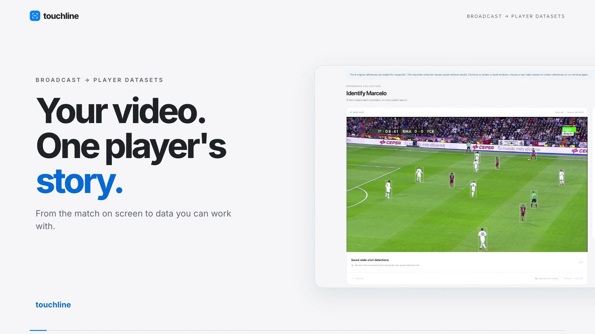
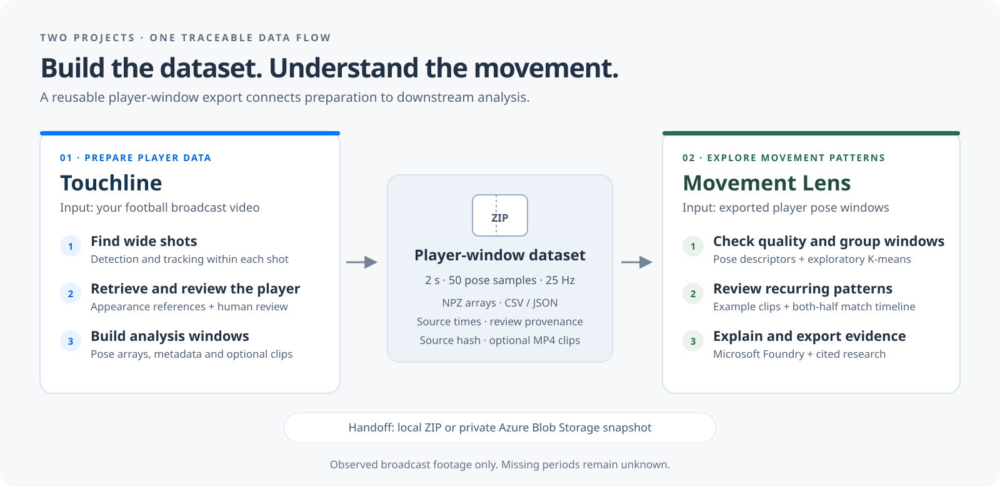
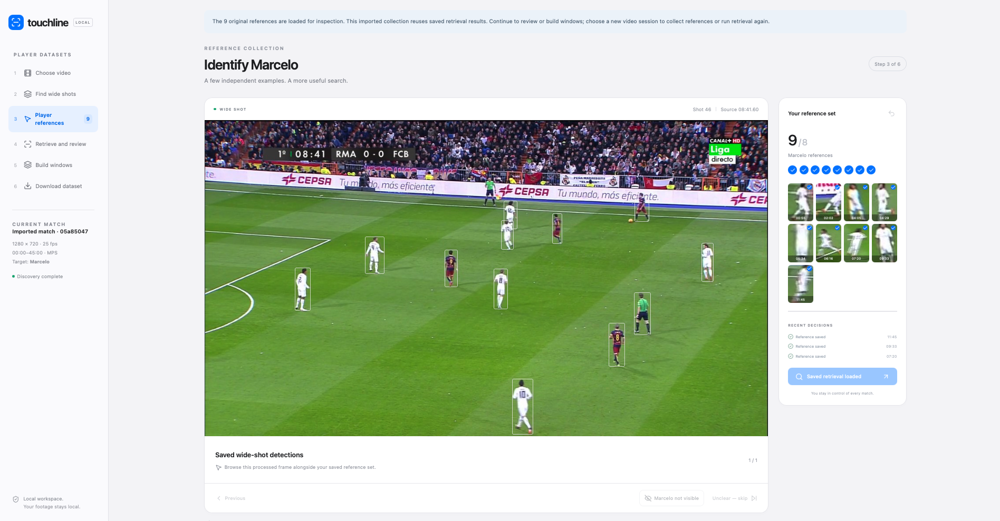
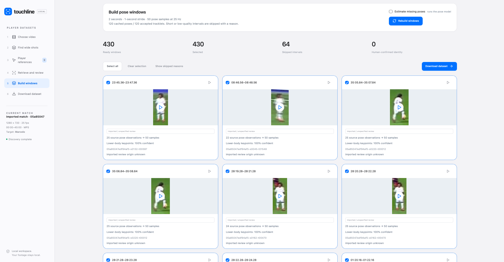
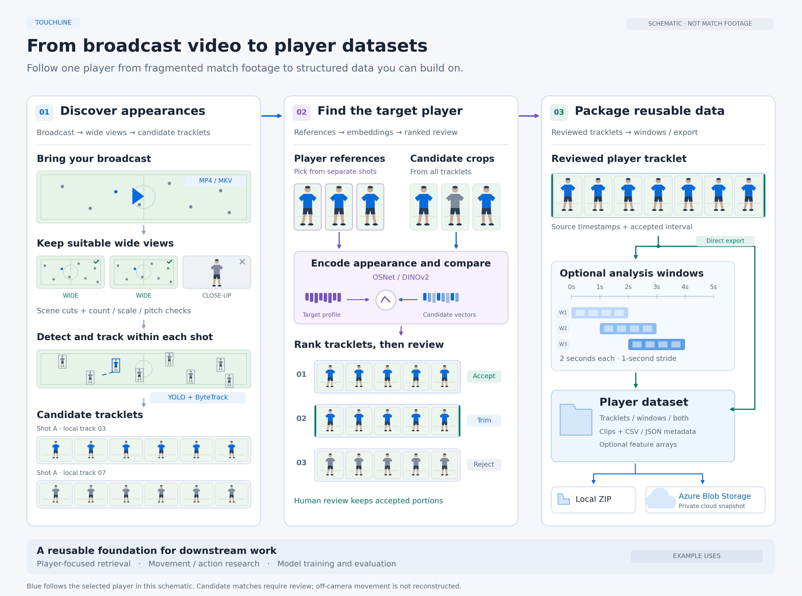

# Touchline

Turn football broadcast video into reviewed player tracklets and analysis windows.
A local FastAPI + React application for preparing traceable player datasets for
downstream analytics.

Dedicated player-tracking feeds and continuous wide-angle footage are not always
available. Touchline makes the player appearances visible in an ordinary broadcast
reusable: discover them, review the target identity, and export the observations
with their source timestamps and quality metadata.

**Choose video → Find wide shots → Select player references → Retrieve and review
→ Build windows → Download dataset**

[Quick start](#run-locally) · [Dataset handoff](docs/HANDOFF.md) ·
[Movement Lens companion](https://github.com/cweim/movement-lens)

## Watch the demo

[](docs/media/touchline-demo.mp4)

[Watch or download the 1:45 demo](docs/media/touchline-demo.mp4) · 1080p · approximately 11 MB.

The recording shows a saved collection and real reference-selection/review
interactions. Full-match processing is not instantaneous. The current app also
supports private Azure dataset export, verified separately after this recording.
Music and media attributions are in [Demo credits](docs/media/CREDITS.md).

## Two projects, one data flow



**Touchline prepares the data. [Movement Lens](https://github.com/cweim/movement-lens) explores it.**
Touchline remains a general dataset builder. Movement Lens is one concrete downstream
use: check pose-window quality, review numerical movement groups, see their observed
moments across a match, and export a research-grounded evidence pack.

The handoff is a **Windows** or **Both** ZIP, transferred locally or through private
Azure Blob Storage. The apps run independently and share no live database.
[Follow the export → import walkthrough](docs/HANDOFF.md).

## Inside the app

| Select player references | Build reusable windows |
| --- | --- |
| <a href="docs/media/player-references.png"></a> | <a href="docs/media/player-windows.png"></a> |

These screenshots show the saved-session demo. Their window counts and match differ
from Movement Lens's prepared example; they illustrate the format and workflow,
not the same archive being transferred between recordings.

<details>
<summary>See Touchline's detailed detection, retrieval and window pipeline</summary>



Tracking creates candidate tracklets first. Player references guide retrieval;
reviewed tracklets can then be exported directly or organized into analysis windows.
[Full-size diagram and implementation notes](docs/diagrams/README.md).

</details>

## Run locally

Python 3.11+, Node.js 20+ and FFmpeg/FFprobe must be installed.

```bash
python3 -m venv .venv
source .venv/bin/activate
python -m pip install -e '.[test]'
npm ci --prefix frontend
npm run build --prefix frontend
python -m retrieval serve --port 8766
```

Open **http://127.0.0.1:8766**. The server binds to loopback only.

Cached pose windows and metadata exports need no model inference. For processing
new videos, install the detector, identity and pose checkpoints:

```bash
python scripts/setup_models.py --pose
# Optional DINOv2 identity baseline:
python scripts/setup_models.py --dinov2
```

Keep source videos in `data/`, select an existing path, or upload through the app.
Path import leaves the original video in place. Upload copies the selected file.
All displayed times refer to the source file, not the on-screen match clock.

To reuse models or videos stored elsewhere, create **local_settings.json**
(ignored by Git):

```json
{
  "models_dir": "/path/to/models",
  "video_roots": ["/path/to/downloaded/matches", "/path/to/external-drive/videos"]
}
```

`TOUCHLINE_MODELS` overrides the model path. `RETRIEVAL_STATE` selects an independent
runtime directory. Both must be set before starting the server. Source paths
inside an imported collection must remain available for video previews/MP4 export;
pose-array export can work with the drive disconnected.

## Workflow

1. **Choose video.** Select an available MP4/MKV, enter an existing local path,
   or browse/upload a video and enter the target player's name. Full matches,
   halves and shorter clips are supported. Use an existing path to avoid copying
   a large file. Open a saved collection to reuse its processed results. No
   dataset-provider account or cloud subscription is required. Provider catalogue
   and download compatibility APIs are retained but are not part of the app UI.
2. **Find wide shots.** Discover camera cuts and run shot-scoped detection/tracking.
   Pause finishes the current shot; resume reuses completed shots. Wide-view
   filtering is heuristic, not reliable replay recognition.
3. **Player references.** Confirm clean portions from eight independent camera
   shots, or explicitly use the five-reference exception. Trim identity switches.
4. **Retrieve and review.** Rank tracklets using OSNet or DINOv2. Accept, reject or
   trim candidates. Rescoring reuses crop embeddings. Ranking scores are not
   calibrated identity probabilities. Human and automatic acceptance are distinct.
5. **Build windows.** Use cached poses by default. Estimating missing poses is an
   explicit option and can take time. Windows stay inside accepted portions and
   their camera shots; short intervals, poor lower-body visibility and gaps over
   0.4 seconds are skipped with reasons. Preview/select windows in the browser.
6. **Download dataset.** Choose Tracklets, Windows or Both. MP4 generation is
   optional; the default exports metadata/arrays without decoding the source
   video. Optional full-frame context is exported separately from player clips.
   Optionally save the prepared ZIP to private Azure Blob Storage and retrieve
   saved snapshots through the app.

Review changes invalidate dependent window builds and downloads. Rebuild/re-export
after trimming or rejecting a tracklet. Cached pose records remain reusable.
App restarts preserve completed artifacts and mark interrupted builds/exports for
retry. Original source videos are never replaced by a different available video.

## Dataset format

ZIP exports contain `README.md`, `manifest.json`, tracklet and window CSV/JSON
manifests, selected window NPZ files and optionally MP4 clips. Metadata records
source hash/FPS, player, shot/tracklet relationships, source-relative intervals,
review provenance, pose confidence and model versions. Local absolute source
paths are excluded from exported manifests.

Windows are **2 seconds**, with **1-second stride** and **50 pose samples at
25 Hz**. Sample times are `start + arange(50)/25`, ending at `start+1.96`.
These are interpolated pose samples, not 50 independently observed frames.
NPZ files preserve source observation times/frame indices, observed keypoints,
resampled keypoints/confidences, boxes, normalised poses, interpolation indicators
and validity masks. Normalisation centres the skeleton on the hips and divides
by torso length. Zero-valued invalid points must be interpreted using the masks.

No walking/jogging/sprinting annotation is required. This application does not
infer injury, medical status, real-world speed, or unseen off-camera movements.

## Optional Azure export

Azure export stores an exact copy of a prepared ZIP in **your private Azure Blob
Storage container**. It does not process footage in Azure, create a Microsoft
football dataset, or upload the original match. If the ZIP includes MP4 clips,
those clips are included in the cloud copy too. Saving is always an explicit action.

Local processing and downloads work without Azure. The app shows **Setup required**
until the optional SDK and configuration are available; **Configured** means settings
are present, not that cloud access has been verified. A successful save creates a
history entry only after Azure confirms the blob's size and checksum metadata.

1. Obtain an Azure subscription and create a storage account and a **private**
   blob container (for example, `touchline-datasets`). Disable anonymous blob access
   on the account. The app refuses containers with public access enabled and never
   creates resources or changes access permissions.
2. Grant the identity running Touchline **Storage Blob Data Contributor** access
   to that container. Azure role assignments can take time to propagate.
3. Install the optional client libraries and sign in with the Azure CLI:

   ```bash
   python -m pip install -e '.[azure]'
   az login
   ```

4. Set these environment variables **in the terminal that starts the server**:

   ```bash
   export TOUCHLINE_AZURE_ACCOUNT_URL='https://YOURACCOUNT.blob.core.windows.net'
   export TOUCHLINE_AZURE_CONTAINER='touchline-datasets'
   python -m retrieval serve --port 8766
   ```

   Replace `YOURACCOUNT` with your lowercase account name. Use the account endpoint
   only, with no SAS token, container path or connection string. Authentication uses
   `DefaultAzureCredential` (developer sign-in locally; managed identity is supported
   when deployed with appropriate permissions). Credentials never go to the frontend.

5. Prepare a ZIP in **Download dataset**, then select **Save prepared ZIP to Azure**.
   Progress, errors and saved snapshots appear below. **Download from Azure** streams
   through the local backend using its Azure identity, even if the local ZIP is gone.
   It is not a public sharing link. Keep the app's runtime database: it holds export
   history. On another machine, direct Blob access remains possible with permission.

Blobs use `touchline/JOB_ID/SHA256/dataset.zip`. A retry verifies an existing copy
instead of overwriting it; distinct ZIPs are retained separately. A stale local ZIP
cannot be saved. Previously saved exports remain downloadable as historical snapshots
after review changes. Old blobs are not automatically deleted. If the configured
account/container changes, restore a snapshot's destination to download it in the app.

Storage, requests and outbound data can incur charges; no free allowance is assumed.
Provisioning and a live-cloud smoke test are separate setup steps. Local tests use an
in-memory Blob boundary and do not establish a working Azure deployment.

Microsoft documentation: [Blob Storage Python quickstart](https://learn.microsoft.com/azure/storage/blobs/storage-quickstart-blobs-python),
[Azure CLI installation](https://learn.microsoft.com/cli/azure/install-azure-cli),
[Blob Storage pricing](https://azure.microsoft.com/pricing/details/storage/blobs/).

## Import an existing research collection

The importer reads saved `data/pipeline/tracklet_manifest.csv`, pose Parquet files,
job configuration JSON and optional accepted-export manifests. It never opens or
modifies the source research database and never reruns detection or pose models.
It copies only collection metadata/representative images; videos stay in place.

```bash
python -m pip install -e '.[import]'
python scripts/import_collection.py --project /path/to/research-project
```

Imported review decisions are labelled **imported_unspecified**, not human-confirmed.
Historical pose source binding is explicitly unverified: an old cache alone cannot
prove the correct source was used. If original detector boxes are unavailable,
boxes reconstructed from pose records are labelled `pose_estimate`. Imported
collections contain the saved subset, not every candidate from the original
full-match run, and do not include enrolment references. New full discovery and
reference selection are available by importing footage as a new session.

## CLI and verification

```bash
python -m retrieval status
python -m retrieval windows JOB_ID
python -m retrieval dataset JOB_ID --mode both
python -m retrieval dataset JOB_ID --mode windows --include-video
python -m pip install -e '.[test,azure,import]'
python -m pytest -q
npm run build --prefix frontend
```

Tests use isolated temporary databases/videos and cover source timing, trim/gap
boundaries, pose-cache reuse, provenance, selection, exports and stale-data gates.

## Repository boundaries

This folder is a standalone source repository. Runtime databases, source footage,
exports, checkpoints, local settings and dependency folders are ignored by Git.
The approved demo MP4 and its poster in `docs/media/` are intentionally included.
The optional legacy activity service remains for code compatibility; it is not
part of the application journey and no activity records are imported.

Source dataset access is not a redistribution licence. Check the relevant terms
before publishing footage, derivative clips or a populated runtime. Third-party
model code retains its upstream notices, including `retrieval/vendor/TORCHREID_LICENSE`.
See [Third-party notices](THIRD_PARTY_NOTICES.md) for model/dependency sources and
[Publishing checklist](docs/PUBLISHING.md) for the release boundary and video setup.
